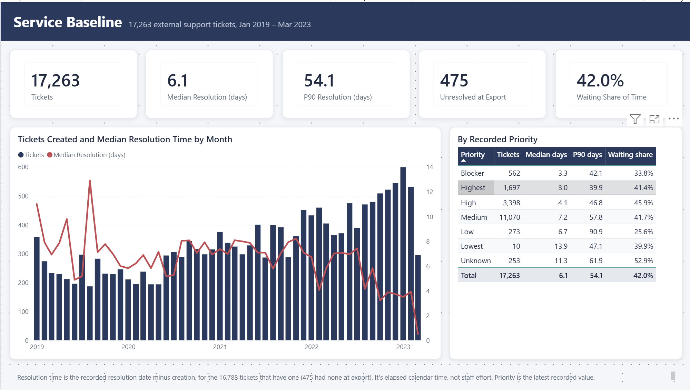
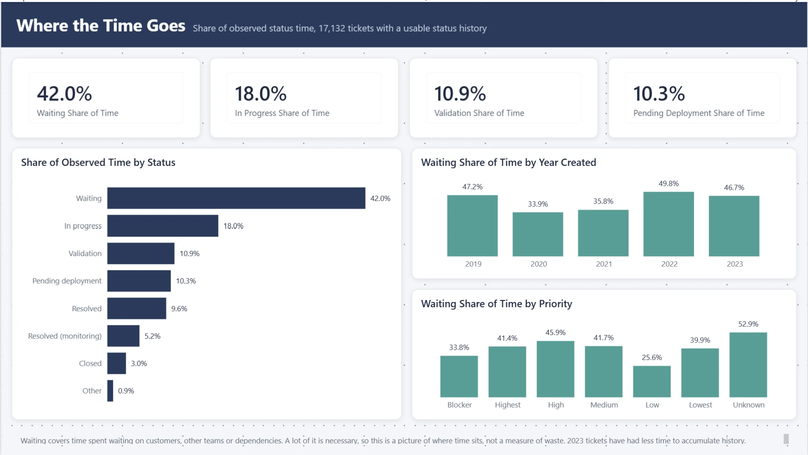
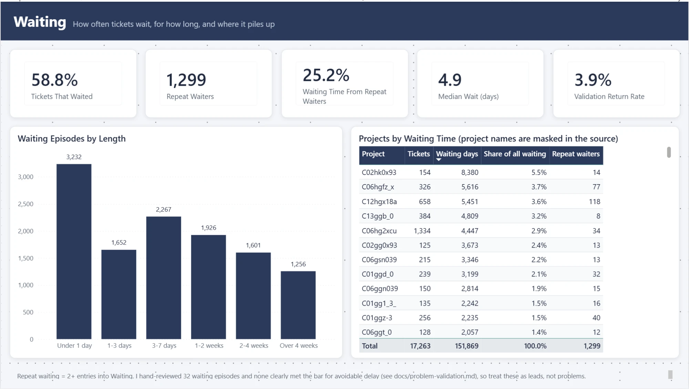

# AI-Native IT Service Operations

The original idea: take a real helpdesk dataset, find the part of the support
process that's actually broken, and only then decide whether AI (or something
simpler) should fix it. Most "AI for IT support" projects I've seen start with the
chatbot and work backwards. I wanted to do it the other way around.

So far this repo is the "find the problem" half. And the honest answer after four
milestones is that this dataset alone **can't prove there's a fixable problem**,
which turned out to be a more interesting result than I expected.

## Data

[Help Desk Tickets v3](https://data.mendeley.com/datasets/btm76zndnt/3) by Mohammad
Abdellatif on Mendeley Data (CC BY 4.0). It's a masked export from a real software
company's helpdesk, with ticket status/assignment history. It also contains
internal project work that isn't support, so a lot of the early effort went into
separating the two.

I compared it against a few other options first (BPI Challenge 2013 and a couple
of incident logs). That comparison is in [docs/dataset-selection.md](docs/dataset-selection.md).

## What I found

Working population: 17,263 external-support tickets created from 2019 on.

- median recorded resolution time is about 6 days, but the mean is 21 and p90 is 54,
  so there's a long tail
- tickets spend **42%** of their observed time in "Waiting"
- 7.6% of tickets go into Waiting more than once, and those account for a quarter
  of all Waiting time
- 827 "validation returns" (work sent back) across 672 tickets

Waiting looked like the obvious target. But when I went through individual
episodes (32 waiting episodes and all 12 validation returns that had text),
none of them clearly met the bar for "this delay was avoidable". A lot of waiting
is legitimately waiting on the customer, on another team, or on a dependency, and
the export doesn't have the timestamps you'd need to tell them apart.

The narrower lead that came out of it: delays around getting diagnostic info from
customers and coordinating dependencies. That needs data this export doesn't have
before it's worth building anything for.

A note on the episode review: I used an LLM to do the first pass on each case and
saved its reasoning next to the source references and packet hashes
(`reports/milestone4/`). Nobody from the actual helpdesk has reviewed those
judgments, so treat them as notes, not ground truth.

Longer write-ups:
- [docs/operational-discovery.md](docs/operational-discovery.md) - baseline numbers
- [docs/problem-validation.md](docs/problem-validation.md) - the milestone 4 review
- [docs/avoidability-evidence-standard.md](docs/avoidability-evidence-standard.md) - what would count as "avoidable"
- [docs/decision-log.md](docs/decision-log.md) - why I made the calls I made

## Dashboard

There's a Power BI version of the baseline in `powerbi/` (open
`service_operations.pbip` in Power BI Desktop). It's meant to show where the work
sits today, not to argue for a fix, so it sticks to the definitions in
[docs/metric-dictionary.md](docs/metric-dictionary.md). Each page has a note at the
bottom saying what the numbers can and can't be used for.







The data comes from three small CSVs in `data/dashboard/` that
`scripts/export_dashboard_data.py` builds from the SQLite db. They're committed, so
the dashboard works without rerunning the whole pipeline. If your copy of the repo
isn't at `C:\Projects\AI-Native IT Service Operations`, change the `DataFolder`
parameter in Power BI (Transform data → Edit parameters) before refreshing.

## Running it

Python 3.11+.

```sh
pip install -r requirements.txt
python scripts/download_data.py        # downloads the dataset, checks sha256
python scripts/profile_data.py         # first-pass profiling -> reports/
python scripts/validate_process.py     # builds data/analytical/service_operations.sqlite
python scripts/discover_operations.py  # milestone 3 numbers
python scripts/validate_mechanisms.py  # milestone 4 waiting episodes + review packets
python scripts/record_mechanism_review.py
python -m unittest discover -s tests -v
python scripts/export_dashboard_data.py  # csvs for the power bi dashboard
```

The SQLite db ends up around 200 MB, so it's not committed. Neither is the raw data.
Two of the bigger milestone 2 CSVs are also left out; `validate_process.py`
regenerates them.

## Layout

```
scripts/   the pipeline, run in the order above
sql/       process reconstruction and episode queries (SQLite)
tests/     25 tests, mostly synthetic edge cases + checks against the real db
reports/   outputs per milestone
docs/      methods, data dictionary, decisions, findings
data/      raw downloads + the built db (gitignored), dashboard csvs
powerbi/   the dashboard (PBIP project)
```

## What's next

Either find data with the missing pieces (when a ticket was actually ready for the
next step, who owned it, response expectations) or reframe this as an observational
study and stop there. Building an AI agent on top of an unproven problem is exactly
what I was trying not to do.
