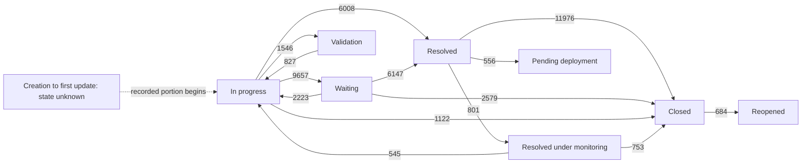

# AS-IS process: customer support tickets

Scope: 17,132 eligible external-project Ticket status traces opened from 2019 onward. The diagram shows common observed transitions, not an ITIL policy or required path. Counts are transition occurrences; a ticket can contribute multiple occurrences.

The dashed connector is an illustrative entry into the observed portion, not an assertion that every ticket first appears In progress. The complete measured edge list, including less common states and returns from Reopened, is in [validated transitions](../reports/milestone2/validated-status-transitions.csv). The dataset also includes Done, cancellation, review and approval paths. No path is classified as correct or incorrect at this milestone.

## Participants and responsibilities supported by data

| Participant/entity | What is observed | What is not established |
|---|---|---|
| Reporter/customer | Masked reporter ID; sampled requests and follow-ups | Complete employee/customer records or business impact |
| Assigned support person | Assignee changes and sampled comments | Actual effort, seniority, support-group hierarchy or job role |
| Other commenters | Explicit `others` role in sample | Whether person is manager, specialist, automation or original support owner |
| Ticket system | State/assignee update records, current fields and grouping IDs | Actor identity for every update; policy enforcement |
| Reviewer in original study | Appraisal scores on a selected sample | Verified optimal operational actions or stakeholder interviews for this project |

## Decision points and exceptions

- A ticket may move from active work to Waiting, Validation, Resolved, Closed or another observed state. The reason for choosing the path is not encoded reliably for the full cohort.
- Resolved may be followed by monitoring or deployment rather than immediate closure. This makes separate state and date definitions necessary.
- Closure may be followed by Reopened. Terminal-looking labels do not imply irreversible process completion.
- Assignment changes occur alongside the status stream. They are not required at every state change, and simultaneous cross-field updates need no invented ordering.
- Missing initial state/owner remains unknown. Conflicting same-field updates and inconsistent endpoints take the diagnostic exception path and are excluded from the applicable metric.
- Sampled text contains support requests, coordination, templates and at least one publisher-described file-sharing case. A Ticket label is not a pure incident taxonomy.

## Questions for operational discovery

Determine where elapsed time and rework concentrate after controlling for cohort and observation coverage. Investigate whether waiting, validation, monitoring and reassignment patterns represent required work, information delays or another explanation. No branch has yet been labeled inefficient, and no AI action or TO-BE workflow is chosen.
