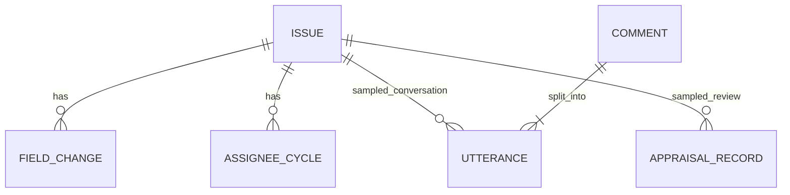
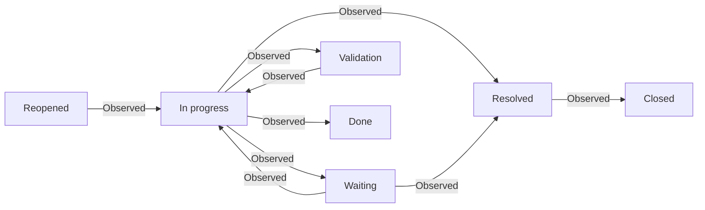

# Business system and initial conceptual model

This Milestone 1 model is retained for history. The validated scope and observed process now appear in `as-is-process.md`, `data-quality-report.md` and `data-dictionary.md`.

This is a software-company helpdesk export containing customer support and other issue-tracked work. Organization name, service catalog, staff hierarchy, contractual SLA targets, labor rates and production access are not supplied. No stakeholder interviews have taken place.

## Entities and relationships

ISSUE is keyed by `id`. FIELD_CHANGE links through `issueid`. ASSIGNEE_CYCLE uses `id` as the issue reference and requires a validated cycle key. UTTERANCE uses `issueid`, comment `id`, and utterance ordering fields. COMMENT is a conceptual grouping of utterances, not a separately supplied full message table. Appraisal joins need further verification. Person/project identifiers are masked; no complete user/project master tables exist.

An issue has an issue type, priority, project, creation date and latest outcome. History records new status or assignee values, with a timestamp and change-group identifier. Issue and assignee-cycle files include publisher-derived measures that will be independently reconciled.

## Observed flow, not an assumed ITIL model

This is a selected subset of measured adjacent updates across the mixed population, using the exclusions in the profile. It is not a complete AS-IS flow, an approved transition policy, or proof that every case starts In progress. Other states include monitoring, review, approval and deployment variants. Initial status capture is still under investigation.

## Initial dictionary and measurement boundaries

| Fields | Meaning/use | Critical restriction |
|---|---|---|
| id, issue_num, issue_proj | Issue key, project-local number and masked project | Preserve source identifiers; do not equate project with support group |
| issue_created, issue_resolution_date | Issue opening and recorded resolution | Elapsed calendar duration only after cohort/censoring validation |
| issue_type, issue_priority | Work type and recorded priority | `unknown` priority is not a valid priority level |
| issue_assignee, issue_contr_count | Final assignee and publisher contributor count | Final state is not intake state; contributors are not handoffs |
| issue_status, issue_resolution | Latest status and outcome label | Labels do not establish root cause or a verified technical fix |
| history.field, value, created | Status/assignee updates | Multiple changes can share one group/timestamp |
| wf_*, wfe_* | Derived state times/visit counts | Validate units, null semantics and calculation against history |
| started, ended, turn | Snapshot cycle boundaries/sequence where supplied | Ownership interval does not equal labor spent |
| actionbody, created, author_role | Masked sampled utterance, time and speaker role | Limited selection; technical placeholders; role mapping needs scrutiny |
| Q1, Q2, Q3 | Human appraisal ratings | Not optimal-action or safe-remediation labels |

The source FEATURES.md is retained unmodified. Differences already observed: source prose says `issues_snapshots.csv` and `scored_issues_snapshot_sample.xlsx`; actual files are `issues_snapshot.csv` and `issues_snapshot_sample.xlsx`. The dictionary spells the utterance issue key `issuedid`; actual header is `issueid`. Raw schema wins for parsing. Meaning discrepancies stay open for investigation.

Candidate measures: issue volume by validated service cohort, elapsed resolution, state revisits, assignment transitions and state occupancy. Unsupported now: SLA compliance (no contract/target table), first-contact resolution, actual staff utilization, labor cost, avoided work and real post-intervention improvements. A complete AS-IS and any TO-BE model follow validated discovery.
